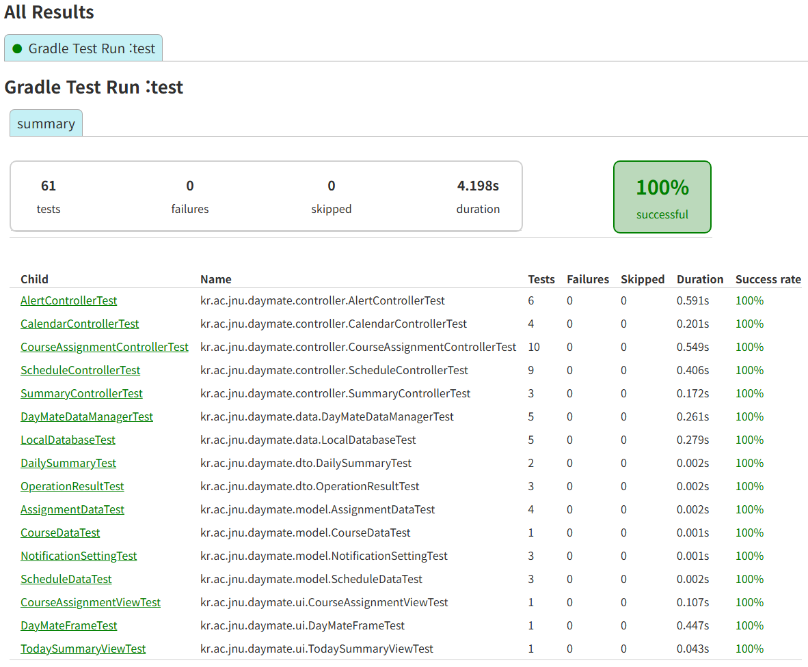

# DayMate

DayMate는 대학생을 위한 Java Swing 기반 개인 일정 관리 프로그램입니다. 수업, 시험, 회의, 개인 약속, 수강 과목 및 과제를 한곳에서 관리하고, 오늘의 일정과 과제 마감 정보를 쉽게 확인할 수 있도록 설계했습니다.

## 주요 기능

- 수업, 시험, 회의 및 개인 약속 등록·수정·삭제
- 반복 일정 설정
- 수강 과목 및 과제 관리
- 월간·주간 캘린더 조회
- 오늘의 일정 및 과제 마감 요약
- 일일 요약 알림 설정 및 확인

현재 SQLite 기반 로컬 저장소, 일정 및 과목·과제 관리, 월간·주간 캘린더, 오늘의 요약, 일일 요약 알림과 메인 화면 연결까지 구현되어 있습니다.

## 기술 구성

- Java 17
- Java Swing
- Gradle Wrapper (Groovy DSL)
- JUnit 5
- SQLite + Xerial SQLite JDBC
- Javadoc API 매뉴얼

## 실행 및 검증

### 실행 환경

- Java 17 이상
- Git

Gradle Wrapper와 내장 SQLite 데이터베이스를 사용하므로 별도의 Gradle 및 데이터베이스 서버를 설치할 필요가 없습니다.

### 저장소 Clone

터미널에서 저장소를 Clone하고 프로젝트 최상위 폴더로 이동합니다.

```shell
git clone https://github.com/junhee-go/Software-System-Design-26-2.git
cd Software-System-Design-26-2
```

프로젝트 최상위 폴더는 `build.gradle`, `settings.gradle`, `gradlew`, `gradlew.bat` 파일이 있는 위치입니다.

### 애플리케이션 실행

프로젝트 최상위 폴더에서 다음 명령을 실행합니다.

Windows:

```powershell
.\gradlew.bat run
```

macOS/Linux:

```bash
./gradlew run
```

### 테스트 및 문서 생성

| 작업 | Windows | macOS/Linux |
| --- | --- | --- |
| 테스트 실행 | `.\gradlew.bat test` | `./gradlew test` |
| Javadoc 생성 | `.\gradlew.bat javadoc` | `./gradlew javadoc` |
| 전체 검증 및 JAR 생성 | `.\gradlew.bat verifyDayMate` | `./gradlew verifyDayMate` |

#### 테스트

테스트는 일정·과목·과제 관리, 반복 일정 조회, 오늘의 요약, 알림 처리, SQLite 저장 및 메모리 캐시 일관성을 검증합니다. 자세한 테스트 결과는 `build/reports/tests/test/index.html`에서 확인할 수 있습니다.



#### Javadoc API 매뉴얼

Javadoc은 소스 코드의 Javadoc 주석을 바탕으로 패키지, 클래스, 생성자 및 메서드의 설명을 HTML 형식으로 생성하는 Java API 문서 도구입니다. Javadoc 생성 명령을 실행하면 API 매뉴얼 전체가 `build/docs/javadoc/`에 생성되며, `build/docs/javadoc/index.html`을 열어 확인할 수 있습니다.

### 전체 검증 및 실행 가능 JAR 생성

`verifyDayMate`는 테스트 실행, Javadoc 생성 및 런타임 의존성을 포함한 실행 가능 JAR 빌드를 함께 수행합니다.

생성된 실행 가능 JAR은 `build/libs/ssd_personal_project-1.0-SNAPSHOT-all.jar`에 저장되며, 다음 명령으로 실행할 수 있습니다.

```shell
java -jar build/libs/ssd_personal_project-1.0-SNAPSHOT-all.jar
```

## 데이터 저장

데이터는 `${user.home}/.daymate/daymate.db` 경로의 내장 SQLite 데이터베이스에 저장됩니다. 프로그램이 데이터베이스와 스키마를 자동으로 생성하므로 별도의 데이터베이스 서버나 계정 설정은 필요하지 않습니다.

## 패키지 구조

```text
kr.ac.jnu.daymate
├─ ui          Swing 화면과 입력 대화상자
├─ controller  입력 검증과 사용 사례 제어
├─ data        SQLite 저장 및 메모리 캐시 관리
├─ model       일정, 과목, 과제, 알림 도메인 모델
└─ dto         처리 결과와 화면 전달 데이터
```

## 동작 범위

- 일일 요약 알림은 프로그램이 실행 중일 때만 동작합니다.
- 단일 사용자의 로컬 환경을 대상으로 하며 계정 동기화나 서버 백업은 제공하지 않습니다.
